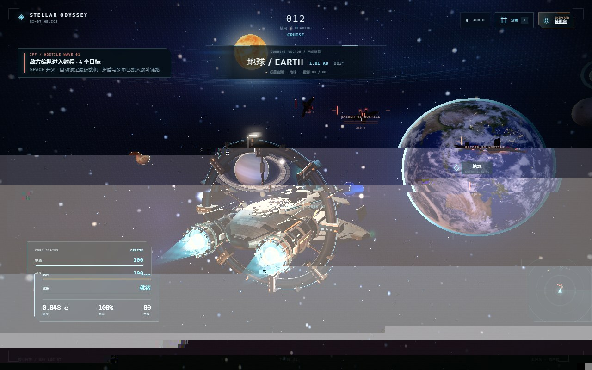
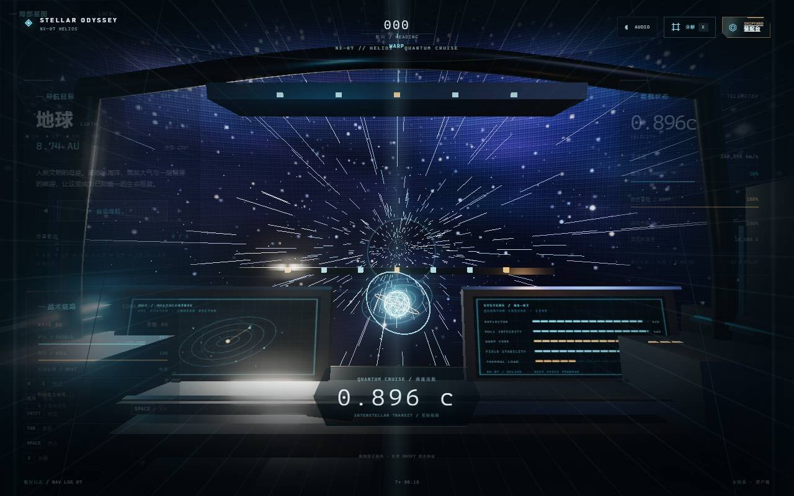
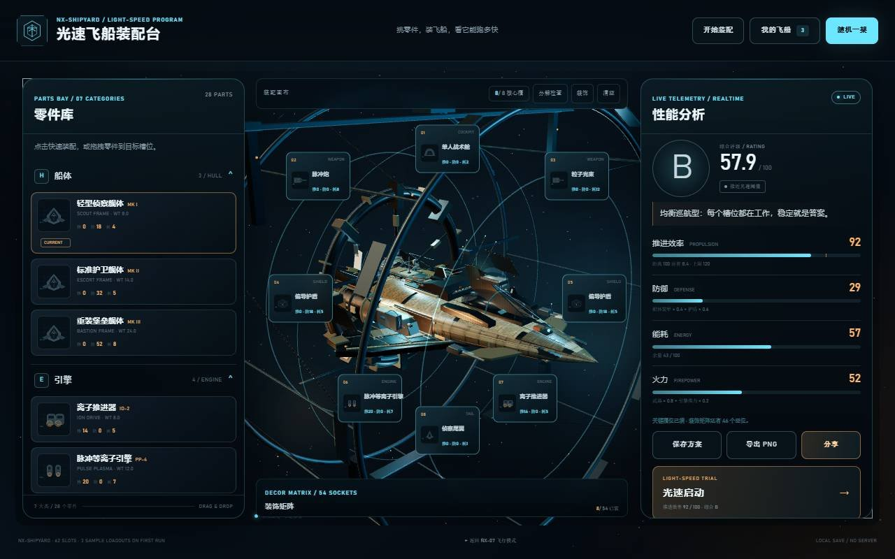
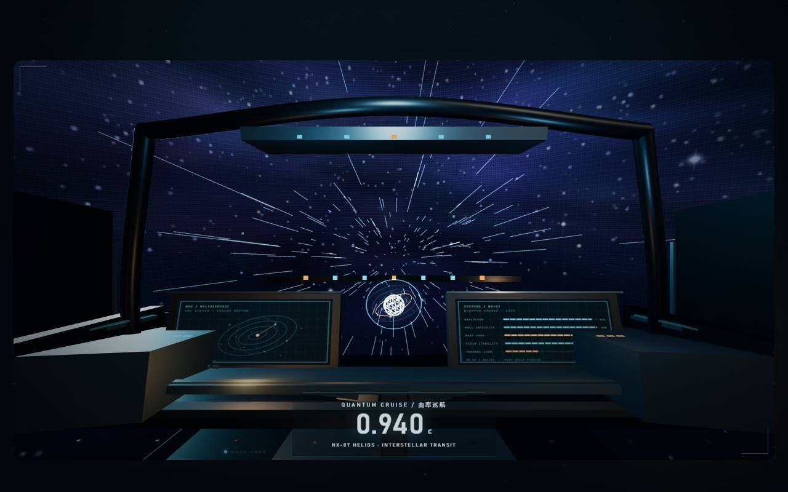
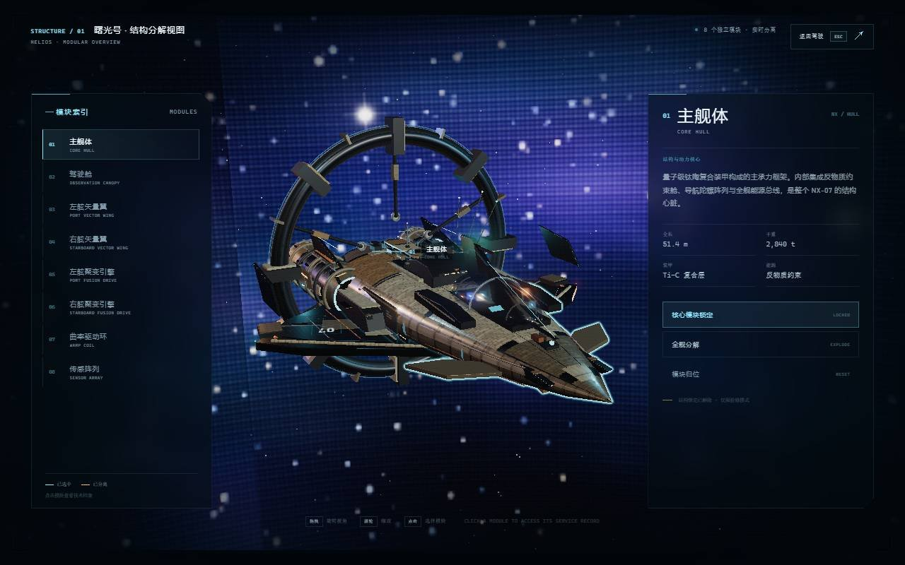
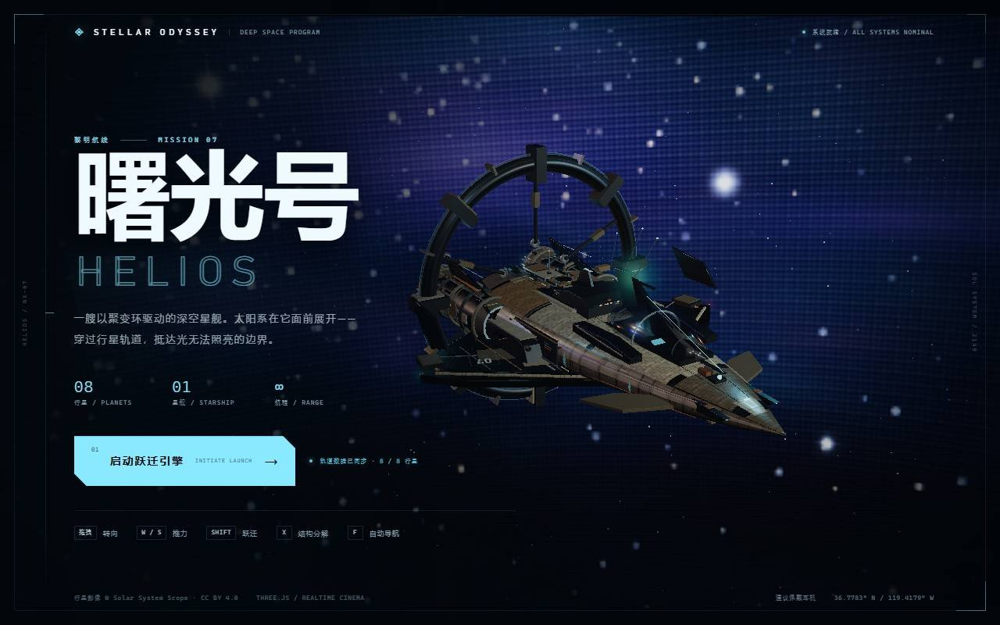

# STELLAR ODYSSEY · 曙光号 NX-07

一艘穿越太阳系的电影级光速星舰，一次可自由拆解的深空航行，以及一间把零件变成飞船的装配台。

项目基于 **Three.js / WebGL 2**，纯静态、无构建步骤。包含完整太阳系背景、八颗可勘测行星、第三人称飞行与第一人称曲率巡航、模块化星舰拆解、中文优先的深空 HUD，以及同一艘 NX-07 的 **3D 轨道船坞装配台**。









## 在线试玩

- **飞行模式**：https://ycmaiball.github.io/stellar-odyssey/
- **3D 光速飞船装配台**：https://ycmaiball.github.io/stellar-odyssey/shipyard/

建议使用桌面版 Chrome / Edge / Safari，并开启硬件加速。

## 启动

ES Module 需要通过本地 HTTP 服务加载，直接双击 `index.html` 无法运行。

```powershell
cd stellar-odyssey
python -m http.server 8000
```

打开 **http://127.0.0.1:8000/**（飞行），或 **http://127.0.0.1:8000/shipyard/**（3D 装配台）。

没有 Python 时，可使用任意静态服务器，例如 `npx serve .`。推荐 Chrome / Edge / Safari 的最新版本，并开启硬件加速。

## 舰长账号

首次进入会要求登记一个飞船账号（呼号 3–16 位字母 / 数字 / `_` / `-`，昵称 2–12 字，密码至少 8 位且含字母与数字）。登录后开始界面右上角显示当前舰长与「切换账号」。

- 口令用 `PBKDF2-HMAC-SHA256`（210,000 次迭代、16 字节随机盐）派生后保存，浏览器里不落明文；校验使用常量时间比较。
- 会话默认 30 天，刷新页面会自动恢复；连续 5 次错误口令锁定 1 分钟。
- 账号、会话分别存放在 `localStorage` 的 `stellar_odyssey:accounts:v1` / `stellar_odyssey:session:v1`，可在浏览器控制台清空。
- 当前是纯前端原型（无后端）；账号数据模型、错误码与 REST 契约见 [`docs/user-system.md`](docs/user-system.md)，接后端时按该契约为准。

## 合约与打捞

飞行模式会自动接取三段轮换的合约，进度显示在任务条下方的小卡片里：

- **勘测**：抵达指定行星完成扫描，报酬 180 CR。
- **清剿**：击毁 4 艘敌对拦截机，报酬 220 CR。
- **回收**：打捞 3 枚残骸核心（击毁敌机有几率掉落，靠近自动回收），报酬 260 CR。

每完成一份合约结算 CR 与经验，经验累计决定军衔（见习舰长 → 上尉 → 少校 → 星区指挥官）；结算后约 6 秒派发下一份，卡片会显示「接收下一份合约 · N s」。进度按舰长账号持久化在 `localStorage` 的 `stellar_odyssey:contracts:v1:<账号 ID>`，换账号互不影响；未登录时归入 `guest`。

## 积分 · 解锁 · 返航检修

进入游戏先落到装配台，首次登记只发一套基础配置：侦察舰体、离子引擎 ×2、偏转护盾 ×2、脉冲炮 ×2、单人驾驶舱、矢量尾翼，装饰位全空。其余 22 件零件需要积分解锁，价格 180–2400 CR；锁定卡片会显示 `LOCKED` 与价格，点击后弹出解锁面板。

- **积分来源**：击落敌机 +45 CR、勘测一颗行星 +120 CR、合约 180 / 220 / 260 CR。积分与经验按账号持久化在 `stellar_odyssey:profile:v1:<账号 ID>`，旧的合约余额会在首次读取时自动迁入。
- **右上角积分**：飞行 HUD 右上角固定显示 `◈ N CR`，变化时数字滚动；击落敌机还会有 `+45 CR` 从积分牌下方上浮。
- **终止航行**：右侧竖排按钮，触发后弹出确认卡（击落数、航时、舰体、积分），确认后播放返航跃迁，回到装配台的入坞动画，再进入「回港检修」。
- **回港检修**：维修价 `ceil((100 − 舰体) / 100 × 240) + 40 CR`，可选全额修复、部分修复（约 55% 价）或带伤出航。舰体完整度持久化，带伤出航会以当前破损状态开始下一段巡航；若回到船坞时已归零，船坞会应急补到 20% 以保证还能起飞。
- **追踪导弹**：`R` 或移动端导弹键发射，每架次 4 发、3.2 秒装填，自动追踪锁定目标（与激光共用锁定），单发 38 点伤害并附带二次爆炸；弹药用尽或装填中会提示。


## 操作

| 输入 | 功能 |
| --- | --- |
| 鼠标拖拽 / 方向键 | 转向 |
| `W` / `S` | 增加 / 减少推力 |
| `A` / `D` | 偏航 |
| `Q` / `E` | 滚转 |
| `SHIFT` | 曲率跃迁 · 进入第一人称巡航（消耗跃迁蓄能） |
| `F` | 自动导航至当前目标 |
| `TAB`（按住）| 战术扫描：展开导航、遥测、战斗面板与全尺寸雷达 |
| `T` | 切换行星目标 |
| `SPACE` | 锁定敌方目标并开火（按住连射） |
| `R` | 发射追踪导弹（每架次 4 发） |
| `X` | 进入 / 退出结构分解视图（装配台内为「分解检查」） |
| `M` | 静音 |
| `ESC` | 飞行中呼出「终止航行」确认；其余界面返回 / 退出 |

移动端提供触屏拖拽转向与「推进 / 跃迁 / 目标 / 自动 / 分解 / 开火」按钮。

## 飞行 HUD 与反馈

常驻 HUD 只回答四个问题：当前目标与距离、护盾 / 舰体、武器热量、速度与曲率。其余信息收进战术层：

- 顶部窄任务条显示当前目标、方位与航程；左下角是护盾、舰体、武器热与速度遥测；右下角是收缩态雷达。
- 按住 `TAB` 展开战术扫描（目标、遥测、战斗面板与全尺寸雷达），松开放回电影感画面。
- 命中会触发准星反馈与击杀确认，受击按来源方向闪烁红色边缘并伴随镜头震动；敌舰较多时只有锁定目标与最近敌舰显示完整读数，其余自动收成紧凑标记。

### 飞行镜头

飞行镜头是刚体锁定式的：相机始终位于舰体正后方的轴线上（无侧向偏移、无前视偏移），并直接以全舰视觉中心为注视点，因此舰体恒定停在屏幕正中、舰首永远指向画面纵深，转向时是宇宙在环绕，而不是飞船在漂移。

- 相机与舰体之间没有位置阻尼，转向完全由飞船自身姿态驱动，所以鼠标 / 拖拽输入可以更跟手；触控输入阻尼与偏航、俯仰、滚转速率都已上调。
- 相机上方向只混入 10% 的舰体滚转，地平线保持水平，压弯时既有倾斜感又不会让整个世界翻过来。
- 曲率航行超过阈值后镜头会自动过渡到座舱第一人称视角，退出后回到刚体锁定的第三人称。

## 战斗

飞行模式会遭遇敌对掠夺者编队（RAIDER）。敌舰会绕行、锁定并发射红色等离子弹，命中会依次消耗护盾与舰体：

- 玩家护盾 100、舰体 100；护盾在脱离命中约 4.6 秒后自动恢复，舰体不会自愈。
- 按住 `SPACE`（或移动端「开火」）自动锁定前方最近的敌舰并发射双联青色脉冲，持续射击会积累武器热量，过热后需等待冷却。
- 左下角常驻核心状态显示护盾、舰体、武器温度与击落数；按住 `TAB` 可展开完整战术链路（波次、锁定目标、全尺寸雷达）。
- 击落当前编队后会进入下一波，敌舰数量和强度逐步提高。舰体归零时显示「曙光号失联」，可点击「重新部署」满状态重返战斗。

## 星舰拆解

在飞行中按 `X`，进入结构检视视图。默认以装配态近距离展示舰体细节，点击「全舰分解」可展开为独立模块；点击左侧模块列表或舰体上的模块，可查看技术档案并自动高亮：

- **01 主舰体** — 量子级钛陶复合装甲承力框架（锁定，不可分离）
- **02 驾驶舱** — 双座全景指挥舱
- **03 / 04 左舷 / 右舷矢量翼** — 独立姿态控制翼
- **05 / 06 左舷 / 右舷聚变引擎** — 双联聚变推进单元
- **07 曲率驱动环** — 曲率场发生器
- **08 传感阵列** — 深空导航与勘测阵列

除主舰体外，七个模块均可独立分离、接回；曲率环会连同能量弧一起展开。视图支持拖拽旋转与滚轮缩放。

## 光速飞船装配台

游戏启动按钮直接进入装配台（必须先装好 8 个核心槽才能起飞）；飞行 HUD 右上角的「装配台」可随时返回改装。改装完成后点击装配台右下角的「光速启动」，镜头会切入带真实 3D 仪表台、双侧系统屏、全息导航球与舱内灯组的驾驶舱，飞船从船坞加速穿越星河，并直接转场至飞行模式。也可直接打开 `/shipyard/`。

- **3D 轨道船坞**：进入装配台时，左右两侧的零件库与性能面板先收起，顶部/底部等非核心界面同步静默；两侧完全退出后，NX-07 才从远处减速、滑入船坞、磁力夹具合拢，可随时跳过；装配全程在真实的 3D 飞船模型上完成。
- **零件库**：船体、引擎、护盾、武器、驾驶舱、尾翼、装饰七类共 28 个零件，每个零件都有独立的 3D 模型与矢量缩略图，带推力 / 防御 / 能量参数。
- **装配画布**：8 个功能槽 + 54 个装饰槽，共 62 个槽位；支持点击装配、拖拽吸附、悬停高亮、右键卸下；换装时旧零件弹出、新零件飞入并吸附，并在画面下方给出「最大两项数值变化 + 一句话判断」。
- **窄轨配件库**：桌面端零件库默认收成 58px 的竖向分类窄轨，点击展开完整卡片；性能面板只保留评分、四维条与「下一步建议」。
- **性能实时结算**：推进效率、防御、能耗、火力四条进度条，S / A / B / C 评级与舰型判读，全部按配置公式计算；推进 ≥ 100 会提示可进入光速状态。
- **机库**：方案命名、保存、载入、改名、删除，以及 1600×1000 的装配海报 PNG 导出。
- **分享**：一键导出当前飞船 PNG，并生成不超过 60 字的分享文案（方案名 + 综合评级 + 一句话点评），可在弹窗中复制；纯本地，不连接社交平台。
- **观察与分解**：拖拽旋转、滚轮缩放、双击复位；点「分解检查」可展开八个独立模块，再点「合拢检查」收回。
- **光速启动转场**：在装配台右下角一键起飞，约 3.6 秒内从船坞外景平滑推入第一人称驾驶舱；3D 仪表台、双侧系统屏、全息导航球、A 柱与舱内灯组逐渐显露，舱外是持续拉流的星河与星场，随后直接进入飞行模式；可随时跳过。
- **响应式**：窄屏下零件库变为抽屉，3D 画布与性能面板纵向排列；手机也能完成一艘船。
- **本地持久化**：方案保存在 `localStorage`（前缀 `lightspeed_shipyard:v1:`），首次打开自动生成三艘示例舰。

零件配置、公式、存储与静态部署说明见 [shipyard/README.md](shipyard/README.md)。

## 玩法

从地球轨道出发，沿导航目标探索太阳系。接近行星至勘测距离后自动记录影像，完成八颗行星的勘测任务。曲率跃迁会消耗蓄能，等待恢复或使用自动导航接近目标；进入曲率后，镜头会平滑切入程序化 3D 驾驶舱——拱形舷窗、仪表台、左右系统屏、全息导航球、控制杆与舱内灯组共同构成第一人称的未来驾驶体验，舱外星流与星空持续拉出速度感与尺度感。完成全部八颗行星后，航行日志会记录用时与总航程，并可继续自由漫游。

行星距离与航速经过艺术化压缩，HUD 中 1 个场景单位按 50,000 km 展示；这不是轨道力学模拟，而是一场为节奏与尺度感调校的深空航行。

## 技术实现

- **渲染**：Three.js 0.169、ACES Filmic Tone Mapping、sRGB 输出、DPR 上限 2（移动端 1.6）
- **后期**：`RenderPass → OutlinePass → UnrealBloomPass → OutputPass → 自定义调色 ShaderPass`（暗角、边缘色散、胶片颗粒）
- **行星**：真实 Solar System Scope 表面贴图；地球使用昼夜贴图、法线、云层透明通道与夜面城市灯光 Shader；土星环独立透明材质
- **星舰**：全程序化建模，约 3,600 行模块代码；八模块层级、曲线放样舰体、分段陶瓷/石墨复合装甲、舰桥与前向传感结构、侧舷任务舱与散热鳍、重型曲率环、引擎尾焰 Shader、能量弧、导航灯与舷窗
- **材质细节**：程序化陶瓷/石墨面板底色、缝隙、检修口、警示条、舷号与微表面贴图；独立展示灯光与装配式检视视角
- **交互**：射线拾取、模块轮廓高亮、独立分离状态机、HTML 标签空间投影
- **飞行**：局部四元数姿态控制、曲率速度与蓄能、行星引力井碰撞、带障碍规避的自动导航
- **第一人称曲率**：相机机位绑定舰体，程序化 3D 驾驶舱（仪表台、双侧系统屏、全息导航球、A 柱与顶置控制台、舱内灯组）、CSS 星流隧道、HUD 降亮与速度读数；退出跃迁后平滑回到第三人称
- **环境**：程序化银河带 / 星云 / 星场、太阳耀斑、小行星带、远景星壳、PMREM 环境光
- **音频**：纯 Web Audio 合成环境声、推进器、跃迁与勘测提示音，无外部音频文件
- **界面**：中文优先、响应式 HUD、触屏控制、行星标记与雷达、启动 / 勘测 / 模块 / 完成四种界面状态
- **战斗**：程序化掠夺者编队、波次生成、绕行/锁定/射击 AI、双联脉冲弹道、护盾优先伤害、武器热量与过热、击落特效、失败重建、敌舰屏幕标记与雷达接触
- **3D 装配台**：复用飞行模式的 NX-07 模型与八模块结构，28 个零件的独立 3D 模型，程序化轨道船坞与对接动画，安/卸零件动画，8 功能槽 + 54 装饰槽实时投影，拖拽 / 点击装配、公式结算、localStorage 机库、Canvas 海报与分享



### 启动界面



## 目录

```text
stellar-odyssey/
├─ index.html                 # 界面骨架与 ES Module 入口
├─ css/styles.css             # 深空 HUD 视觉系统
├─ src/
│  ├─ main.js                 # 场景、飞行、相机、后期、玩法循环
│  ├─ world.js                # 太阳系、行星、天空、光照
│  ├─ ship.js                 # NX-07 程序化建模与模块拆解
│  ├─ combat.js               # 敌舰 AI、武器、护盾、弹道与波次
│  ├─ textures.js             # 程序化天空、星点、舰体贴花
│  ├─ audio.js                # Web Audio 音景
│  ├─ ui.js                   # HUD / 标注 / 面板 / 提示
│  ├─ auth.js                 # 飞船账号注册、登录、会话与锁定
│  ├─ contracts.js            # 合约轮换、CR / 军衔结算与残骸打捞
│  └─ utils.js                # 数学、绘制、文本纹理工具
├─ shipyard/
│  ├─ index.html              # 装配台界面、3D 画布与槽位层
│  ├─ styles.css              # 装配台视觉系统与响应式布局
│  ├─ app.js                  # 零件配置、公式、拖拽、机库、导出
│  ├─ scene3d.js              # Three.js 船坞、NX-07 与零件模型、换装动画
│  └─ README.md               # 配置 / 公式 / 部署文档
├─ docs/user-system.md        # 账号系统设计、数据模型与接口契约
├─ assets/textures/           # 行星贴图与处理脚本
├─ assets/screenshots/        # 项目截图
└─ vendor/                    # 本地 Three.js 与后期模块
```

## 致谢与许可

- 行星纹理：**Solar System Scope** — [solarsystemscope.com/textures](https://www.solarsystemscope.com/textures/)，采用 [CC BY 4.0](https://creativecommons.org/licenses/by/4.0/) 许可。项目内已对纹理做尺寸与格式适配，界面与文档中保留署名。
- 渲染引擎：**Three.js**，MIT License。
- 其余场景、星舰建模、Shader、界面与音频均为本项目原创实现。

---

**STELLAR ODYSSEY / NX-07 HELIOS**
*穿过行星轨道，抵达光无法照亮的边界。*