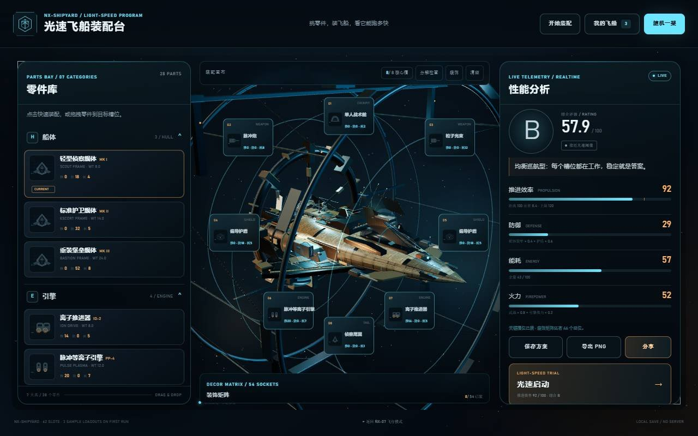
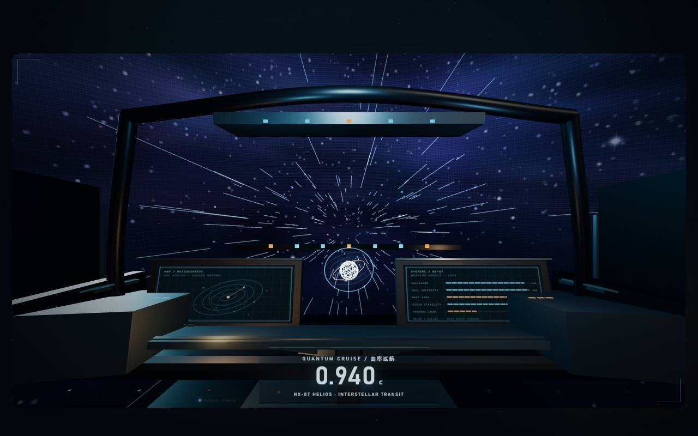

# 光速飞船装配台 · NX-SHIPYARD

“挑零件，装飞船，看它能跑多快。”

这是 STELLAR ODYSSEY 项目中的 3D 轨道船坞装配台。它复用飞行模式中的 NX-07 飞船模型与八模块结构，在程序化空间站里完成对接、选件、换装与分解检查；装配数据、交互和界面独立运行，不需要启动飞行场景。





## 在线版

https://ycmaiball.github.io/stellar-odyssey/shipyard/

## 启动

在项目根目录启动任意静态服务器：

```powershell
cd stellar-odyssey
python -m http.server 8000
```

打开：

- 飞行模式：`http://127.0.0.1:8000/`
- 3D 装配台：`http://127.0.0.1:8000/shipyard/`

装配台也可以直接部署到任意静态主机的 `/shipyard/` 子路径；全部路径都是相对路径，没有构建步骤。

## 使用方式

- **进入船坞**：首次打开或重新载入时，左右两侧的零件库与性能面板会先收起，顶部与底部等非核心界面同步静默；确认两侧完全退出画面后，NX-07 才从远处减速滑入轨道船坞，夹具合拢。对接动画约 3.5 秒，可点「跳过对接」；进场过程中不会弹出其他界面抢走焦点。
- **观察 3D 舰体**：在中央场景拖拽旋转、滚轮缩放、双击恢复默认视角；左/右两侧为悬浮零件库与性能面板。
- **分解检查**：点「分解检查」展开八个独立模块，再点「合拢检查」收回，可近距离查看每个零件。
- **点击零件卡片**：自动装到对应类别的空槽；如果槽位已满，会打开替换面板；旧零件会弹出，新零件会飞入并吸附。
- **零件缩略图**：28 张卡片预览不是矢量占位图，而是由独立离屏渲染器逐件生成的 192×192 PNG——统一哑光金属 + 冷色辉光、斜侧视角和深色底，每件零件的角度略有差异，缩略图独占 58px 方形列，不压文字。
- **拖拽零件卡片到槽位**：半透明零件预览跟随鼠标，命中可安装槽位时描边发光并放大；松手后吸附安装，放错槽位会弹回并提示正确类别。装饰零件可以拖到 54 个装饰槽中的任意一个。
- **点击已装槽位**：打开同类别替换面板。
- **右键已装槽位**：直接卸下零件。
- **开始装配**：清空当前画布，装出你自己的舰船。
- **全速推演**：顶部切到全速推演后，零件库、性能面板与建造时序一起压暗收拢；48 颗青蓝 / 琥珀光点沿三层轨道环流，围绕舰体模拟加速，右侧只留评级内核、四项数值与推演结论。
- **我的飞船**：载入、改名、删除、导出 PNG、复制分享文案。
- **导出 PNG**：直接由 Canvas 合成装配海报，文件名包含飞船名与日期。
- **分享**：导出当前飞船的 1600×1000 PNG，并生成不超过 60 字的分享文案（方案名 + 综合评级 + 一句话点评）；弹窗内可一键复制，不连接任何社交平台。
- **光速启动**：镜头从船坞外景平滑推入第一人称曲率驾驶舱，仪表台、双侧系统屏、全息导航球与舱内灯组逐渐显露，舱外是持续拉流的星河与星场；约 3.6 秒后直接转场至飞行模式，随时可跳过。

在窄于 900px 的屏幕下，左侧零件库会变成抽屉；3D 画布和性能面板纵向排列，手机也能完成一艘船。窄屏的 3D 场景会保留完整的轨道船坞和八模块飞船，只收起两侧面板。

## 零件配置

所有配置都在 `shipyard/app.js` 的前两个区块：

1. `CONFIG`：存储前缀、方案上限、发射时长、槽位数量、公式权重与评级阈值。
2. `CATEGORIES`：七个零件分类及默认展开状态。
3. `PARTS`：28 个零件的完整数据。

一个零件的数据结构如下：

```js
{
  id: 'engine-fusion',       // 全局唯一
  category: 'engine',        // 必须属于 CATEGORIES 中的 id
  name: '双环聚变引擎',
  en: 'FUSION TWIN',
  mk: 'FT-7',
  weight: 16,                // 影响推进效率
  armor: 0,                  // 船体装甲，参与防御
  energy: 8,                 // 能耗，参与能量上限
  thrust: 26,                // 推力，参与推进与火力
  defense: 0,                // 护盾防御，参与防御
  firepower: 0,              // 武器火力
  description: '……'
}
```

新增同类别零件时，只需要往 `PARTS` 里追加对象，零件库和替换面板会自动更新。若修改的是类别名、槽位数量或公式权重，请同步检查 `CONFIG`、`CORE_SLOTS`、`DECOR_COUNT` 以及 `computeStats()`。

### 公式

```text
propulsion = engine thrust × 100 / (hull weight + other weight × 0.6)  // 上限 120
defense    = hull armor × 0.4 + shield defense × 0.6
energy     = 所有零件 energy 之和                                    // 上限 100
firepower  = weapon firepower × 0.8 + engine thrust × 0.2
score      = propulsion×0.35 + defense×0.30 + firepower×0.25 + (100−energy)×0.10
rating     = S ≥ 85 / A ≥ 70 / B ≥ 55 / C < 55
```

权重、上限和阈值都在 `CONFIG.performance` 与 `CONFIG.rating` 中，不写死在渲染层。

## 本地存储

- 前缀：`lightspeed_shipyard:v1:`
- 方案上限：20 个；超出时会提示先清理旧方案。
- 首次打开自动写入三个示例方案：星梭·侦察型、壁垒·护航型、雷霆·突击型。
- 当前草稿与方案都保存在浏览器 `localStorage`，不会上传服务器。

需要重置演示数据时，在浏览器控制台执行：

```js
localStorage.clear();
location.reload();
```

## 导出

PNG 由 `drawPoster()` 在首页 Canvas 上绘制，包含飞船矢量图、吨位/装饰统计、四项性能和评级。导出不需要后端，也不会把方案数据发送到网络。

## 目录

```text
shipyard/
├─ index.html      # 页面骨架、3D 画布、槽位与弹层
├─ styles.css      # 深空视觉系统、悬浮面板、响应式抽屉
├─ app.js          # 配置、公式、DOM 渲染、拖拽、存储、导出
├─ scene3d.js      # Three.js 轨道船坞、NX-07、28 个零件模型与换装动画
└─ README.md
```

## 静态部署

将整个 `stellar-odyssey/` 项目上传到任意静态托管（GitHub Pages、Netlify、Cloudflare Pages、S3、Nginx 均可），确保：

- 以项目根目录为站点根；
- `/shipyard/` 能访问到 `shipyard/index.html`；
- 服务器以 `text/javascript` 返回 `.js` 文件。

无需 Node、数据库或环境变量。

## 技术说明

- 原生 HTML/CSS/JavaScript + Three.js，无构建步骤、无框架。
- `scene3d.js` 复用飞行模式的 `createShip()` 模型与八模块层级，并为 28 个目录零件分别建立 3D 模型；轨道船坞、夹具、扫描门与灯光均为程序化几何。
- 对接、零件弹出/飞入、吸附、分解检查与相机缓动都在 `scene3d.js` 中完成；左侧零件库与右侧性能面板保持 DOM 交互，槽位卡片通过 3D 锚点投影定位。
- 拖拽使用 Pointer Events 自绘预览层：移动阈值、命中校验、槽位发光/放大、吸附安装、错误回弹与类别提示；触屏保留点击安装，不阻断列表滚动。
- 分享文案优先使用 `navigator.clipboard`，失败时提示手动复制。
- 所有数值都来自配置，公式只负责计算。

## 与飞行模式的关系

原有 NX-07 飞行游戏完整保留在项目根目录，并与装配台共用同一艘 3D 飞船模型。飞行启动界面右上角的「装配模式」与飞行 HUD 右上角的「装配台」都可进入装配台；装配台右侧操作区不再保留飞行模式按钮，改装完成后点击右下角「光速启动」，飞船会播放起飞动画并直接转场至飞行模式。页脚和左上角品牌标记仍可快速返回飞行模式。